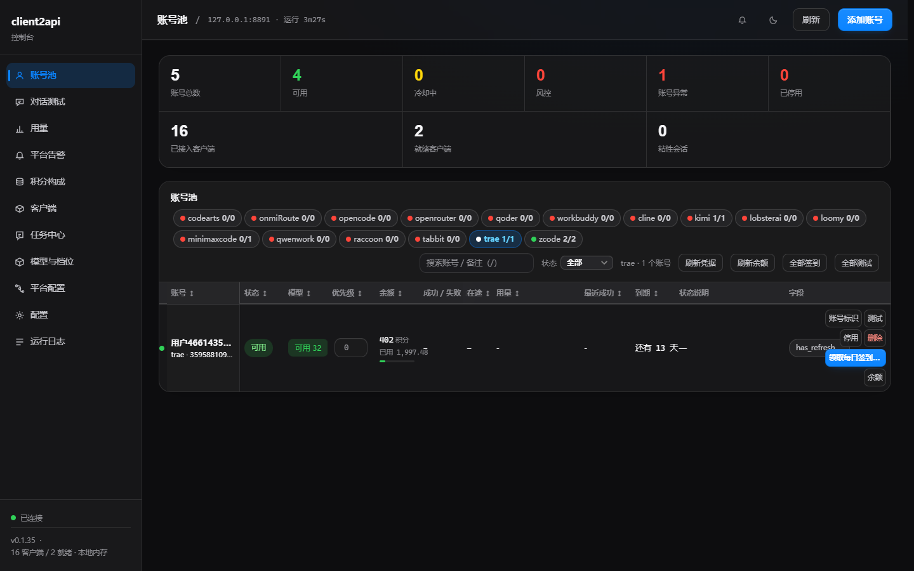
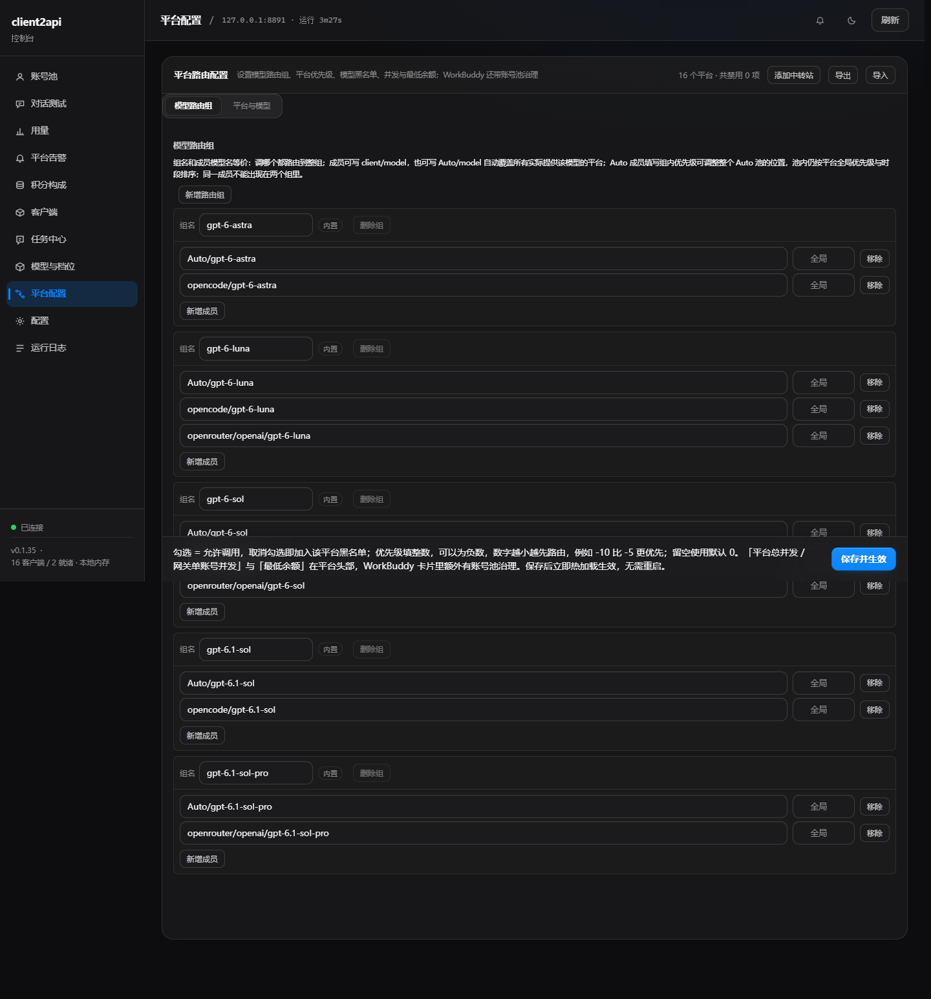
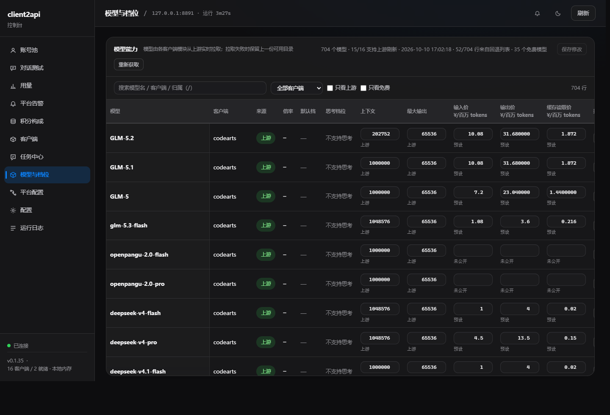
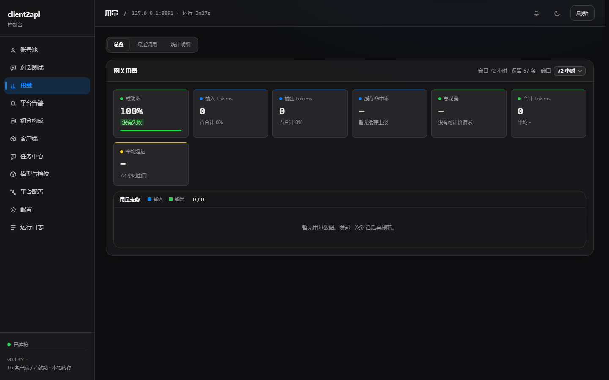
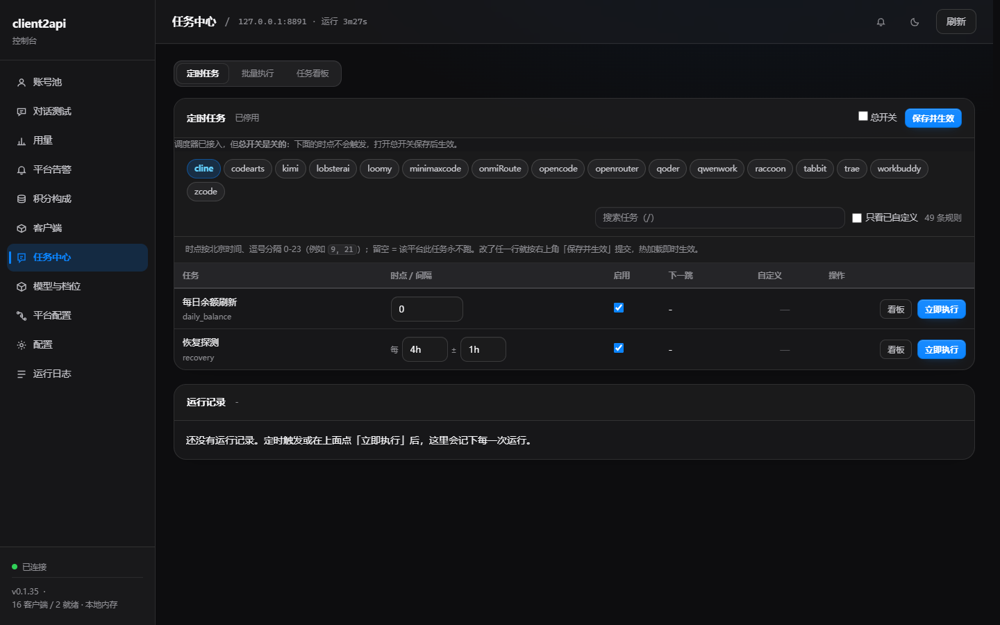
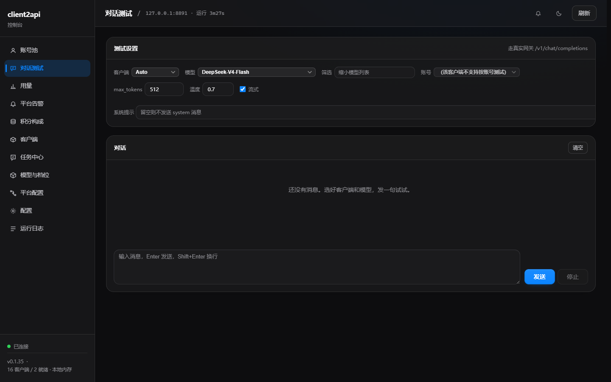

# client2api

[English](README.md) | [简体中文](README.zh-CN.md) | [使用教程](TUTORIAL.zh-CN.md)

[](https://github.com/Cvencent/client2api/actions/workflows/go-binaries.yml)
[](https://github.com/Cvencent/client2api/releases)

当前版本：**0.4.5**。完整更新记录见 [CHANGELOG.md](CHANGELOG.md)。

流式断流排查：升级后系统日志新增 `stream: id=...` 终止诊断，包含协议、平台/模型、
上游事件数、`finish_reason`、正文/推理字节数、工具调用数、completion token、
首包耗时、总耗时及终止原因；达到输出上限时标记为 `terminal=incomplete`。
日志不记录对话正文或凭据。

client2api 是一个**个人自用**的 OpenAI 兼容网关。它把你自己在各个 AI 客户端/平台上拥有的账号和 API Key 聚合起来，对外只提供一套统一的 OpenAI 风格接口和网页管理面板。

> **仅限个人自用、学习使用。**
> 本项目不面向公网、不做共享中转、不提供服务器架设方案。请只在自己机器上运行，不要暴露到互联网，不要拿它当作给他人提供服务的平台。程序默认只监听 `127.0.0.1`。
>
> 使用本项目时，请遵守每个上游平台的账号规则、服务条款和 API 政策。不要用它绕过额度限制、转卖访问权限或架设公开代理服务。



## 项目定位

- 聚合你自己拥有的账号和 Key，而不是提供一个公共账号池。
- 用一个入站 API Key 统一调用 `POST /v1/chat/completions`、`POST /v1/responses`，以及 Anthropic 入站 `POST /v1/messages` / `POST /v1/messages/count_tokens`。
- 为带语音能力的平台提供 `POST /v1/audio/transcriptions`：上传 WAV/FLAC/MP3/MP4/M4A/OGG/WebM 可返回 `{"text": "..."}`、纯文本、SRT、verbose JSON 或 VTT。
- 在平台、账号、模型别名、`Auto/<模型>` 和模型路由组之间统一调度。
- 平台支持会话粘性时，同一会话会尽量落在同一个账号上。
- 统一处理账号优先级、冷却、并发限制、重试和故障切换。
- 可选出口中继：可以走已有的 HTTP/SOCKS 代理，也可以由本进程托管 mihomo 并加载订阅。
- 通过网页面板管理账号、任务、用量、模型、积分、日志和配置。
- 支持 Windows 安装包、便携发布包和源码本地构建。
- 凭据和运行数据都只保存在本机 `data/` 目录。

## 支持的平台

| 路由 | 客户端 / 平台 | 上游服务 |
|---|---|---|
| `workbuddy/...` | WorkBuddy | 腾讯 WorkBuddy / CodeBuddy（国际版 + 国内版） |
| `autoclaw/...` | AutoClaw | AutoClaw 桌面端（独立平台） |
| `trae/...` | Trae | TRAE SOLO / Trae CN |
| `zcode/...` | ZCode | Z.AI coding plan |
| `kimi/...` | Kimi | Kimi Code CLI |
| `qoder/...` | Qoder CN | Qoder CN |
| `qwenwork/...` | QwenWork | 千问办公 / QoderWork CN |
| `tabbit/...` | Tabbit | Tabbit 浏览器 |
| `minimaxcode/...` | MiniMax Code | MiniMax Code |
| `gemini/...` | Gemini | Google Cloud Code Assist（Antigravity） |
| `cline/...` | Cline | Cline |
| `lobsterai/...` | LobsterAI | 有道龙虾 LobsterAI |
| `codearts/...` | CodeArts | 华为 CodeArts |
| `loomy/...` | Loomy | 讯飞 Loomy |
| `raccoon/...` | Raccoon | 商汤小浣熊 Raccoon Work |
| `openrouter/...` | OpenRouter | OpenRouter |
| `opencode/...` | OpenCode Zen | OpenCode Zen |
| `kilocode/...` | Kilo Code | Kilo AI Gateway |
| `doubao/...` | Doubao | 字节跳动 豆包（桌面客户端 / 网页） |
| `doubaoime/...` | Doubao IME | 豆包输入法在线语音转写（仅转写） |
| `officeace/...` | OfficeAce / 华为 | 华为 MaaS / AgentArts（内置，显示为 **华为**） |
| `openai-compat/...` | onmiRoute | 旧兼容来源 |
| `<source-id>/...` | 自定义中转站 | 自己添加的任意 OpenAI 兼容平台 |

### 免费模型与免费额度账号

另外两件事很容易混淆：

- **免费模型**是厂商自己定价为 0 的模型。网关会标记 `extra.free` 并优先于付费候选；在已接入账号侧规则的平台，余额为 0 被冷却的账号仍能服务它，只有「上游拒绝了本账号调用这个模型」才会把这一对账号+模型停掉。WorkBuddy、Cline、CodeArts、Raccoon、QwenWork、OpenRouter、Kilo Code、OpenCode 都实现了这条规则。
- **免费额度账号**是账号会拿到积分、试用套餐或每日赠送。这些额度会被付费模型消耗，所以用之前先看「模型与档位」页里的倍率。

实时模型目录才是权威：厂商会随时新增、下线或改价，下面两张表是起点，不是固定清单。

| 路由 | 免费模型（零价 ID） | 免费额度账号 / 周期性领取 |
|---|---|---|
| `openrouter/...` | 有：只有输入价和输出价都为 `0` 的 ID 才算免费；`free_only` 默认开启。 | 没有签到；用你自己的 OpenRouter Key 会消耗该账号的免费额度，厂商还会限制每天免费模型调用次数。 |
| `kilocode/...` | 有：匿名免费层，`free_only` 默认开启，实时目录为准。 | 匿名账号无需登录（共享、默认每 IP 每小时 200 次请求）；登录或 API Key 账号走自己的免费模型限额。 |
| `opencode/...` | 有：匿名免费域；`free_only` 默认开启，厂商 `-free` 后缀 ID 会被识别。 | 匿名 `x-api-key: public` 无需登录；登录 OpenCode Console 的账号也可以服务免费 ID。 |
| `cline/...` | 有：厂商 `free` 数组为准，`free_only` 默认开启。 | 没有签到，只支持 WorkOS 设备登录。 |
| `gemini/...` | 有：Google Cloud Code Assist / Antigravity 免费线。 | 没有签到；额度是厂商的 5 小时/周滚动窗口，不是积分余额。 |
| `officeace/...` | 没有逐模型零价标记；四个可选模型都消耗试用/活动积分。 | 新登录会自动开通免费 `officeace.personal.package.trial`：500 `officeace_points` + 200 次联网搜索；新用户、每日签到等奖励会在「套餐」页拆开显示。 |
| `workbuddy/...` | 有：有效倍率为 `0` 或促销窗口已开启的模型即为免费，厂商免费标签也算。 | 国内每日签到；国际版每日活跃对话。免费促销只在有效期内生效。 |
| `codearts/...` | 有：从网关配置读取厂商的免费额度（benefit）模型清单。 | 套餐满足 `is_credit_package` 时可每日签到。 |
| `qwenwork/...` | 有：厂商 `credits` 倍率解析为 `0` 的模型标为免费。 | Sash 每日签到。 |
| `raccoon/...` | 有：有效 `billing_multiplier` 为 `0`（含限时活动）即为免费。 | 桌面登录发放接口延长每日 300 积分有效期；该奖励厂商只发给自己的桌面客户端。 |
| `loomy/...` | 内置目录不是零价；用每日赠送额度消费。 | 每日首次登录赠送额度。 |
| `qoder/...` | 由实时目录决定；免费/付费由厂商 Credits 决定。 | 活动开放时领取每日 `CLAIM_BENEFIT` Credits。 |
| `tabbit/...` | 由实时目录决定。 | 每日签到会返还一部分额度（面板显示为使用百分比）。 |
| `minimaxcode/...` | 由实时目录决定。 | 七天连续每日签到积分。 |
| `lobsterai/...` | 由实时目录决定；厂商中文「免费额度已用完」会把账号标记为已耗尽。 | 每日签到，约 +100 积分。 |
| `autoclaw/...` | 由实时目录决定。 | 每日领取积分。 |
| `trae/...` | 由实时目录决定。 | 国内每日签到和 1024 活动；观察到的福利包（例如 4000 积分）从厂商权益包读取。 |
| `zcode/...` | 由实时目录决定。 | 领取活动套餐（token 权益；任务看板的奖励单位显示为积分）。 |
| `doubao/...` | 由实时目录决定。 | 显示积分和套餐额度；未实现签到。 |
| `kimi/...` | 未实现免费模型或免费积分机制。 | 没有签到。 |
| `openai-compat/...`、自定义中转站 | 取决于厂商，平台自己的 `/models` 扫描结果为准。 | 厂商支持时可通过 New API、Sub2API 或 OpenAI Billing 协议读取余额。 |
| `doubaoime/...` | 仅语音转写。 | 没有对话额度。 |

代表性免费 ID（来自内置/回退表，使用前请在面板刷新）：

| 平台 | 免费 ID |
|---|---|
| OpenRouter | `openrouter/free`；实时输入价和输出价都为 `0` 的任意 `vendor/model:free` |
| Kilo Code | `kilo-auto/free`、`stepfun/step-5-preview-free`、`nvidia/nemotron-3-ultra-550b-a55b:free`、`nvidia/nemotron-3-super-120b-a12b:free`、`nvidia/nemotron-3.5-lightning:free`、`nvidia/nemotron-3-nano-omni-30b-a3b-reasoning:free`、`dots-studio/dots-3-note-preview:free`、`thinkingmachines/inkling-small:free`、`poolside/laguna-s-2.1:free`、`poolside/laguna-xs-2.1:free`、`cohere/north-mini-code:free`、`liquid/lfm-2.5-2.6b:free`、`inclusionai/ling-3.1-flash`、`stealth/glyph-cluster` |
| OpenCode Zen | `space-bunny-free`、`deepseek-v4-flash-free`、`mimo-v2.6-flash-free`、`mimo-v2.5-free`、`nemotron-3-ultra-free`、`nemotron-3.5-lightning-free`、`jev-1.13-free`、`longcat-2.5-preview-free`、`ling-3.0-flash-fin-free` |
| Cline | `stealth/space-bunny-alpha`、`cline-free/mimo-v2.6-flash`、`cline-free/gemini-3.8-flash`、`cline-free/muse-spark-1.3-contributor`。`cline-free/deepseek-v4.1-flash` 已在 2026-10-04 移到付费 `cline-pass/*`，下一次刷新会消失。 |
| Gemini | 实时目录；内置回退为 `gemini-3.8-flash`（low/medium/high 变体会合并成一行）。 |
| OfficeAce | `officeace/glm-5.2`、`officeace/glm-5.1`、`officeace/deepseek-v4-flash-0731`、`officeace/deepseek-v4.1-flash`（由试用积分支付，不是零价）。 |
| CodeArts | 厂商免费额度清单；回退为 `glm-5.3-flash` 和 `deepseek-v4.1-flash`。 |
| WorkBuddy | 实时目录和促销，例如 `hy4-preview` 在 23:00-08:00 夜间免费；`glm-5.2` 是 0.50x 夜间折扣，不是免费模型。 |
| QwenWork | 实时目录；内置 ID 为 `pro`、`flash`、`qwen3.8-max-preview`，是否免费由厂商倍率决定。 |
| Raccoon | 实时目录；内置 ID 包括 `sn-glm-5-3`、`sn-kimi-k3`、`sn-glm-5-3-flash`、`sn-deepseek-v4-1-flash`，是否免费由 `billing_multiplier` 决定。 |

表里是厂商模型 ID；调用网关时要在前面补平台路由，例如 `kilocode/kilo-auto/free`、`cline/cline-free/gemini-3.8-flash`、`opencode/space-bunny-free`、`openrouter/openrouter/free`。

## 功能总览

### 网关与路由

- OpenAI 兼容的 `POST /v1/chat/completions` 和 `POST /v1/responses`。
- Anthropic Messages 入站兼容 `POST /v1/messages` 与 `POST /v1/messages/count_tokens`，支持 Claude Code 常用的字符串或 block content、system、tools、tool result、thinking、usage、流式 SSE、非流式响应和 Anthropic 风格错误；任何能处理翻译后对话请求的平台都可以服务它。
- OpenAI 兼容的 `POST /v1/audio/transcriptions`（multipart 的 `file` + `model`）；
  `GET /v1/models` 会把语音平台的模型一并列出并标记 `extra.kind = "transcription"`。
- `GET /v1/models`、`GET /v1/status`、`GET /healthz`。
- 所有平台共用一个入站 API Key，面板可选本地鉴权。
- 支持 `平台/模型`、裸模型名、别名和 `Auto/<模型>` 聚合路由。
- 支持自定义 `model_groups`，把同一模型在各平台的不同名字绑成一组。每个组名都会在
  `extra.supported_efforts` 中固定发布 `low/medium/high/xhigh/max` 五档，具体成员仍按
  各自的 effort 策略处理。
- 支持操作者设置对外模型白名单（`exposed_models`）：网关先按路由结果生成完整的对外目录
  （`平台/模型`、`Auto/<模型>`、`model_groups` 组名、别名和转写模型），再只放行被勾选的最终
  ID。每个最终 ID 独立控制——勾了组内成员不会自动开放组名，勾了别名目标不会自动开放别名。
  以 `/*` 结尾的条目表示只开放这个平台前缀下的全部模型，例如 `my-relay/*`，不会影响其它平台。
  匹配忽略大小写和首尾空格。未配置表示全部开放；显式 `[]` 表示全部关闭。白名单同时作用于
  `GET /v1/models` 和所有调用入口（对话、Responses、Messages、count_tokens、语音转写），
  被隐藏的 ID 即使按名字调用也会被拒绝。白名单只约束外部调用方；面板的**对话测试**属于运维
  自己的内部工具，会带上 `X-Client2API-Internal-Test: 1`，因此它能列出并测试全部可路由的
  模型（含未公开的），否则这个页面就测不了正要上线的模型。该请求头只在已经通过入站鉴权的
  `/v1/*` 上生效，不额外授予权限。
- 平台优先级、账号优先级和按北京时间生效的分时优先级。
- 可选 `egress` 出口中继。`client` 模式接受 HTTP、HTTPS、SOCKS5 或 SOCKS5H 代理地址；`subscription` 模式会把订阅 URL 交给本进程托管的 mihomo，并把网关流量指向它的 loopback mixed port。启用后优先于顶层 `proxy`；修改这个配置需要重启进程。
- 平台级、账号级、账号内并发限制。
- 会话粘性、重试、冷却和自动故障切换；面板会列出粘性会话使用的模型，可强制解绑账号，也可在强制切换时指定目标平台；不指定时则清除账号和平台粘性并重新按优先级选择。切换前已经发出的请求可以正常完成，但它的成功回调不能再把旧平台粘性写回来；下一次请求会从操作员的最新选择重新选路。
- 统一把鉴权、额度、WAF、超时、限流等错误映射为 OpenAI 形状。
- 厂商拒绝凭据时，各平台统一显示为「账号异常」而不是「冷却中」。401 无论 body 写什么（厂商业务信封、泛化的 `token expired`、还是边缘网关那段裸 HTML）都是对凭据本身的判定：无法自行续期的模块直接把账号停用为 `invalid`，让操作员重新导入，而不是冷却一轮后又把同一个死令牌放回轮换。能续期的模块先试一次刷新，且只有刷新令牌本身被拒（不是超时或 5xx）才算终态。请求一旦被正常服务，该判定立即清除，所以恢复可用的凭据会自动回到池里，面板的「恢复」也始终能手动解除。
- 部分厂商会在 HTTP 200 的 SSE 流里返回额度、鉴权、限流或 WAF 错误。网关会在提交流之前先读第一帧；如果这是可重试错误，就关闭该流并交给下一个候选平台，而不是把 502 直接丢给调用方。零余额账号会退出轮换，直到充值、签到或余额刷新读到正数。
- Responses 上下文守卫在本会裁剪时，会折叠旧历史并返回一个 `compaction` 项，而不是静默丢掉最旧的消息；调用方下一轮可以携带这条压缩状态。压缩失败时仍回退到原来的裁剪路径，聊天与 Anthropic 协议没有压缩词汇，仍以 `context_window_exceeded` 回报。
- Responses 自动压缩使用候选平台实际能服务的具体模型 ID；调用方可以写模型组名，但不能再拿组名直接请求模块，否则会报 `ErrUnsupported` 并退回静默裁剪。
- 自动压缩撞上本地 `max_in_flight_per_account` 限制时会等待背压：最多重试 3 次、间隔 200ms，真实上游错误仍立即返回。
- 同一条消息的正文只计一次：调用方可能把同一段文字以字符串或内容数组（`input_text` / `text` 块）发出，入站解码会把数组里的文本块同时写进 `Content` 和 `Parts`，估算器过去会把两处都算上，等于把正文按双倍计。后果是裁剪阈值被提前触发：厂商实测只有约 42 万 tokens 的会话，网关按约 110 万 tokens 的估算在 1048576 的窗口上反复裁掉最早的消息，而这段历史本来能完整放下。现在只有 `Content` 为空、文本块是正文唯一副本时才计分。同一形状还让 Raccoon、Autoclaw、MiniMax Code、Doubao 和 Gemini 在上游报文里把正文发了两遍，这些模块改为优先用 `Content`，仅在其为空时回退到文本块。
- 上下文窗口守卫会把上游拒绝里写明的真实窗口写入 `data/learned_context_windows.json` 并由 `/v1/models` 发布。若拒绝同时给出「实测 N tokens > M maximum」，而请求按估算本应放得下，网关会按实测比例裁剪并立刻重试一次，避免这类对话每次「继续」都报 400。
- 思考档位按“平台 + 模型”解析：优先级为手动配置、模块缓存目录、内置预设；
  “模型与档位”页可以查看和修改支持的档位及默认档，手动值优先于可能过期的模块缓存。
- “封顶对齐”现在对所有平台、所有模型默认开启，包括 `Auto/<模型>` 和模型组行；面板仍可按模型手动关闭或恢复默认。
  开启后，只有请求档位为 `xhigh` 且模型真实最高档更高时才会提升（例如 WorkBuddy、
  Cline、OpenRouter 的 `max`）；较低档位、最高档本来就是 `xhigh` 的模型（例如 Loomy）
  都不改，不会下发厂商从未公布的档位。没有公布思考档位的模型默认开启同样安全，实际是
  空操作。用量记录同时保留请求值和实际下发值，不同时显示为 `xhigh → max`。

### 账号与平台

- 账号池支持启用/停用、备注、身份标识、优先级和余额显示。
- 平台自报免费的模型（倍率为 0、免费额度清单，或名字/分组/模型 id 里带 Free——例如 `cline-free/...`、`vendor/model:free`）按上游的答复路由，而不是按余额：余额为 0 被冷却的账号依然可以服务它，只有「上游拒绝了本账号调用这个模型」才会把这一对账号+模型停下来。与钱无关的冷却照常生效——限流、WAF、会话失效、风控、熔断都不会因为模型免费而放行。目前 WorkBuddy、Cline、CodeArts、Raccoon、QwenWork、OpenRouter、Kilo Code、OpenCode 已接入账号侧规则；模块侧契约是 `core.ChatRequest.FreeModel`，免费判定本身是共享的（`core.ModelIsFree`）。
- Raccoon 的 IAM 短信登录会在读取资料前确认业务会话；仍返回 HTTP 400 / code `200901` 的调用会先确认再重放一次，因此修复前保存的裸令牌账号也会自愈。
- Raccoon 每日 300 积分是被桌面登录发放接口**延长有效期**，不是由它发放：厂商 00:00 发当日额度（当日 24:00 清零），桌面端登录后延长到 7 天。实测这条奖励厂商**只发给它自己的桌面客户端**——网关用同样的 POST、同样的头和令牌一律得到 `granted:false`，账本里 4 次成功全部紧贴桌面端启动时刻。因此本机签到按钮现在记成「不可用（需桌面端登录领取）」而不是失败；若账本证明今天的额度已经延长，则记成「已领取」。
- 支持手动添加、本地凭据发现、整包导入，以及模块支持时的浏览器/设备登录。
- 支持重新登录、恢复、测试、签到、刷新余额和删除账号。
- AutoClaw、Raccoon、LobsterAI、Trae CN 的余额读取自己保证令牌新鲜，不再依赖「碰巧有
  一次测试或聊天顺手续期」：AutoClaw 与 Raccoon 在令牌进入续期窗口时先续期、被厂商以
  鉴权错误拒绝时再续期并重试一次；LobsterAI 对 HTTP 200 响应体里 `code != 0` 的拒绝也
  重试一次；Trae CN 走与聊天、签到相同的 `ensureToken` 路径。AutoClaw 与 Raccoon 的账号
  记录同时补发顶层 `expires_at`，后台空闲续期扫描才会覆盖它们（此前字段为空被静默跳过）。
  令牌过期后不再一直显示「未登录」。
- Gemini / Google Cloud Code Assist 支持 Google OAuth 登录、账号发现与刷新、额度查询，以及 Cloud Code Assist 请求翻译和流式返回。它的模型列表从上游 `fetchAvailableModels` 实时拉取（失败时退到额度桶里的模型名），平台新增或下线模型不需要改代码。浏览器登录开箱即用：模块内置了 Cloud Code IDE 自己的 OAuth 客户端，`client_id` / `client_secret`（或环境变量 `CLIENT2API_GEMINI_CLIENT_ID` / `CLIENT2API_GEMINI_CLIENT_SECRET`）可以换成自己注册的客户端。
- ZCode 可以选择开启单槽验证码参数预取池：请求取用新鲜参数，后台立即补充；默认关闭，因为预取大约会让设备额度消耗翻倍。对应配置是 `captcha_pool` 和 `captcha_pool_ttl_seconds`。
- 「模型」列点开可以逐账号启用/禁用单个模型，所有平台都可编辑：WorkBuddy 沿用模块自己的模型策略（含「强制启用」），其余平台写入网关共享的账号模型黑名单，在下一次请求选取账号时生效。限流中的模型会显示解除时刻和剩余时间。
- 任何上游 429 都会给「平台 + 账号 + 模型」记一段冷却：首次 60 秒，连续失败翻倍，封顶 30 分钟；上游给了 `Retry-After` 就优先用它（同样封顶）。冷却期间网关拒绝该账号的这个模型，模块会换账号或换平台，不再撞同一个限流；账号的模型弹窗会显示解除时刻和剩余时间。模块每次尝试都通过 `core.ChatRequest.NoteAccountFailure` 上报时，即使它已经轮转到别的账号成功也会记上；没有上报的模块由网关在整体失败时兜底记录。
- Loomy 的余额、套餐和模型目录刷新只用于展示：读取失败只在该行报错，不会让账号冷却、异常或停用；账号健康只由真实对话请求或手动「测试」决定。
- ZCode 的 JWT 与 coding-plan API Key 会按同一账号聚合为多条通道。
- OfficeAce（Office Claw）现在内置为 `officeace` 平台，面板里显示为 **华为**，不需要手动添加中转站。打开它的账号池，点 **自动添加** 可以让面板自己租号、驱动华为手机号验证码登录并写入账号；也可以点 **浏览器登录 → 获取授权链接** 自己完成华为账号 OAuth。两种方式都会把返回的模型网关 App Key / App Secret 写进本站账号池，并把模型按 `officeace/<模型名>` 发布。每个账号保留自己登录返回的模型网关地址，因此不同区域或网关的账号可以放在同一个平台里；登录完成后不再依赖 OfficeAce 桌面端在线。Windows 上仍保留 **导入 → 探测本机凭据** 作为已有客户端登录的兜底路径。
- 支持动态添加 OpenAI 兼容中转站，每个平台有自己的 API 地址和 Key 池。
- 每个中转站可以单独配置出口代理 `proxy`（例如 `http://127.0.0.1:7890`、`socks5://127.0.0.1:1080`，也支持 `user:pass@` 写法）：这个中转站发出的全部请求——对话、扫描模型、余额、账号测试——都会走这个代理，其它平台不受影响。留空表示跟随网关的全局代理。 每个中转站还可以单独配置 `user_agent`：个别站按客户端白名单放行，通用 UA 会被拒（401 unauthorized client detected），这里填它期望的客户端 UA，留空用本网关默认。
- 只提供 OpenAI Responses 协议的中转站（如 agentrouter.org），给来源配置加
  `api_format: "responses"` 即可：对话会走 `/v1/responses`。
- 自定义中转站支持独立的限流与冷却策略，且可在面板的“编辑中转站”里直接修改：
  `requests_per_minute` 限制整个中转站每分钟的上游尝试数，`requests_per_minute_per_account`
  限制单把 Key；一把 Key 达到上限时会自动换下一把，全部达到上限才报忙。
  `max_in_flight` / `max_in_flight_per_account` 覆盖平台级和账号级在途上限，留空继承平台配置，
  显式 `0` 表示不限制。`cooldown` 是通用冷却，`rate_limit_cooldown`、`quota_cooldown`、
  `auth_cooldown`、`upstream_cooldown` 分别覆盖限流、额度、鉴权和上游故障；专用值优先于
  通用值，留空使用默认值（限流 30s、额度和鉴权 5m、上游 10s），`0s` 关闭对应冷却。
- 中转站支持扫描模型；扫描失败时保留上一次成功的模型目录。
- 中转站余额刷新支持 `balance_protocol`：`auto`（默认）依次探测 New API `GET /api/usage/token/`、Sub2API `GET /v1/usage`、New API 控制台 `GET /api/user/self`（仅在配置控制台凭据时），最后是 OpenAI Billing 的 `credit_grants` 与 `subscription`。也可固定为 `newapi`、`sub2api`、`openai_billing`，或设为 `none` 关闭查询。
- `balance_quota_per_usd`（默认 `500000`）用于把 New API 的额度单位换算成美元；Sub2API 和 OpenAI Billing 直接按美元读取。
- 账号高级字段 `balance_access_token` 和 `balance_user_id` 可提供 New API 控制台凭据，用于普通 API Key 读不到余额的情况。

### 网页面板

- 账号池
- 账号池首页可点击「粘性会话」，查看实时的账号/平台绑定及其使用的模型，并可强制解绑账号或指定目标平台切换
- 对话测试
- 对话测试里选中转写模型（如 `doubaoime/...`）会自动切换成麦克风录音转写测试：录完直接走
  `POST /v1/audio/transcriptions`，状态码与响应体原样展示
- 对话测试的平台与模型下拉来自 `GET /v1/models` 的完整目录，不受 `exposed_models` 对外白名单
  限制（页面会带内部测试标记），所以它列出并调用的是网关能路由的全部模型，而不是对外公开的那一份
- 用量
- 平台告警
- 积分构成
- 客户端
- 任务中心
- 模型与档位：分为「模型能力」和「对外模型」两个标签。对外模型页可搜索、按类型筛选、
  全选/反选/清空、逐项勾选；保存后写入 `exposed_models` 并热重载，无需重启。配置里存在、
  但当前目录没有的 ID 会保留成 `missing` 行，保存不会丢。
- 平台配置
- 平台配置页的路由链有两个独立按钮。「链路测试」输入模型名后静态显示故障切换顺序、实际模型、优先级和优先级来源，不读账号状态、不发上游请求；「测速」复用同一条链路，按平台逐个通过各自账号池发一次最小真实请求，显示首字延迟、总耗时、实际账号、输出 token 和 tok/s。tok/s 是「请求发出 → 最后一个内容分片」的整体速度，含排队与首字等待，与用量页的 tok/s 口径一致；不用「首字 → 末字」的窄窗口——中转站把回答攒成几个大包下发时，那个窗口会把百來 tok/s 的平台算成四五千 tok/s。结果行可以直接拖动，也可以用「上移/下移」调整顺序；保存后把显示顺序写回平台优先级、模型组成员优先级或分时优先级，并热加载生效。
- 配置
- 运行日志

### 任务、用量与计费

- 定时任务按平台分 Tab，使用北京时间，可逐平台覆盖；间隔支持秒/分钟/小时和对称随机抖动。
- 每日余额刷新支持按时刻、按间隔或 5/6 段 Cron 表达式；已停用账号会被跳过，定时读取不会让账号恢复，只会反复触发厂商拒绝。
- 批量执行和任务看板，覆盖模块支持的各种账号任务。
- 恢复探测、每日余额刷新和签到任务。
- 签到当天已成功、或厂商明确表示该账号当天不可签到时，账号的签到按钮会置灰并显示状态，批量签到也会跳过；网络/鉴权等临时失败仍可点击重试。状态按北京时间跨天自动重置。
- 成功率、延迟、输入/输出 tokens、缓存命中率和最近调用。
- 每条调用显示会话 ID，并支持按模型、按账号统计。
- 人民币费用估算、厂商官方价表、models.dev 回退和手动价格覆盖。
- 积分构成按剩余有效期显示，并有套餐/客户端视图。
- 平台告警和结构化运行日志。

### Responses API

`POST /v1/responses` 是给 Codex 使用的原生 Responses 协议入口，支持：

- `instructions`、字符串或数组形式的 `input`、消息、文本和图片。
- 工具/函数调用及函数结果。
- 命名空间工具声明（`type: "namespace"`，Codex 现在用来暴露 MCP 服务器工具的形状）：
  子工具摊平后发给上游，回包时再拆回 Codex 派发所需的 `(namespace, name)` 二元组。
- 推理摘要和加密 agent 内容处理。
- Codex 解析器要求的流式事件顺序。
- 无状态调用和 `previous_response_id` 兼容行为。
- 「空回合」——`finish_reason=stop`、没有工具调用，也没有任何可用的可见文本（完全没有文本，
  或在带了工具的请求里、长时间推理后只留下一小段「我要去做…」的碎片）——会自动向上游重试一次，
  而不是原样当成正常结束回合返回；这正是让 Codex 收尾并等用户再发一句话的形状。
- 模型把工具调用写成可见文本时，网关会在公共事件层统一归一化：完整的 DSML/XML
  调用会转换成结构化的 `tool_calls`，Chat Completions 和 Responses 都适用；不完整或
  无法解析的标记会让该回合失败，而不是把协议标记当正文透出。
- 上游把 `DSML` 标签丢掉、只留下全角竖线时（`<｜｜ calls>`、`<｜｜ invoke ...>`，
  闭合标签还可能是 `</｜｜｜>`）网关同样认得出来。以前这种写法整段落成普通正文，
  回合以 `tool_calls=0`、`finish_reason=stop` 结束，Codex 直接收尾、工具从未执行。现在标签
  可选、竖线长度不严格，参数也接受裸竖线闭合标签；只有全角竖线算 envelope，ASCII `|` 仍当
  普通文本。

完整翻译规则和限制见详细参考文档。

### OfficeAce 模型直连

OfficeAce（Office Claw）已经内置为 `officeace` 平台，不需要自己添加中转站。桌面客户端实际只提供 4 个可选模型：`glm-5.2`、`glm-5.1`、`deepseek-v4-flash-0731`、`deepseek-v4.1-flash`。它们直接走华为 MaaS / AgentArts 的 OpenAI 兼容模型网关：

1. 打开 **平台配置**，展开 **华为**（内置的 `officeace` 平台）。新装实例默认就有这个平台，行内会标为 **内置平台**，不提供删除按钮。
2. 打开它的账号池，点 **自动添加**：面板会从共享接码平台租一个号码，用无头浏览器走华为手机号验证码登录，自动读取并提交验证码；新账号还要勾选并确认华为云用户协议弹窗（当前 Vue 弹窗和旧版注册页都能识别），弹窗没关掉时会直接报错，而不是卡在授权轮询里。在弹窗里粘贴接码平台 token（或一次性设置 `EOMSG_TOKEN`），发送方关键字保持默认的 **华为**；任务结束后面板会自动释放号码。想自己登录时，原来的 **浏览器登录 → 获取授权链接** 仍然可用；每次获取的新链接都会先退出浏览器里上一个华为会话，再带着原 OAuth 参数回到登录页，因此连续添加第二个账号不会直接登录成前一个账号。两种方式都会用授权码兑换该账号的模型网关凭据并写入本站账号池；新账号会自动开通免费的 `officeace.personal.package.trial`（500 `officeace_points` + 200 次联网搜索），已开通的账号不会重复下单。登录时下单被云端拒绝（比如 IAM 校验瞬时失败）的账号，面板读余额/套餐时会自动补开体验版，每个账号每 30 分钟最多补试一次。
3. 登录成功后会自动扫描模型；之后也可以再点 **扫描模型**。模型按 `officeace/<模型名>` 发布，并且只开放客户端实际提供的这 4 个 ID；华为原始目录里的其他条目会被忽略。

每个账号独占华为登录返回的 `model_api_url_base`，所以不同区域、不同模型网关的账号可以共用一个 `officeace` 平台。请求统一用 **HTTP Basic** 认证，账号轮换、故障切换、会话粘性、用量统计、流式输出和工具调用都与其它平台一致。凭据只保存在本机 `data/officeace/accounts.json`，不会写进配置文件或示例配置，登录完成后不需要 OfficeAce 桌面端一直在线。

登录时拿到的云端临时凭据也会保存在同一个账号里，用来对齐 WorkBuddy 的平台能力：账号池上的 **签到** 按钮调用 OfficeAce 模型网关的每日奖励接口（幂等，重复点击会提示今天已经领过）；**额度/余额** 显示 `officeace_points` 积分和套餐里的联网搜索次数；**套餐** 把套餐配额和每个活动奖励拆开列出。临时凭据过期后会用 refresh token 或 IAM v3/STS 自动续期，同样不需要桌面端在线。

Windows 上仍保留 **导入 → 探测本机凭据** 作为兜底：它会读取 OfficeAce 桌面客户端已经保存的登录（DPAPI + AES-GCM），显示上游地址，并导入 App Key / App Secret。如果该登录指向另一个 OfficeAce 网关，导入后会保留账号自己的网关地址，不再拒绝。两条自动路径都不可用时，才用 **手动添加**：把应用 Key 填进 `API Key / App Key`，展开 **高级设置**，把配套密钥填进 `App Secret`。

账号池也保留了手工接码的四个动作：**取号**、**查验证码**、**释放/拉黑**。token 可以直接在面板里按次粘贴，不需要重启；`EOMSG_TOKEN` 是进程级兜底，华为验证码的默认发送方关键字是 **华为**。

如果要限制对外目录，把 `exposed_models` 设成 `["officeace/*"]` 就只开放 OfficeAce 这一个平台，不影响其它平台。

## 界面截图

| 账号池 | 平台配置 |
|---|---|
|  |  |

| 模型与档位 | 用量 |
|---|---|
|  |  |

| 任务中心 | 对话测试 |
|---|---|
|  |  |

## 快速开始

### Windows 安装包

从 [Releases](https://github.com/Cvencent/client2api/releases) 下载最新的
`client2api-setup-<version>.exe`，双击安装，然后打开：

```text
http://127.0.0.1:8790/panel/
```

端口可以在托盘菜单的“设置”里修改。

### 从源码运行

```powershell
$tools='D:\client2api-lab\_tools'
$env:PATH="$tools\go\bin;$tools\w64devkit\bin;$env:PATH"
$env:GOCACHE="$tools\gocache"
$env:GOTMPDIR="$tools\gotmp"
$env:GOMODCACHE="$tools\gomodcache"
$env:GOFLAGS='-mod=mod'
$env:GOPROXY='off'
$env:CGO_ENABLED='0'
go build -o client2api.exe ./cmd/client2api
.\client2api.exe -config configs\client2api.json
```

默认只监听 `127.0.0.1`。不要让两个实例共用同一个 `data/` 目录，也不要在已安装实例使用端口时再从源码目录启动一个开发实例。

## 文档

- [使用教程](TUTORIAL.zh-CN.md)
- [详细参考文档（中文）](docs/REFERENCE.zh-CN.md)
- [Detailed reference (English)](docs/REFERENCE.md)
- [模块接口契约](docs/MODULE-CONTRACT.md)
- [上游协议记录](docs/upstream)
- [更新记录](CHANGELOG.md)

## 许可与使用范围

本仓库面向个人使用、学习和研究。它不授予任何搭建公网或商业中转服务的权利，也不会改变任何上游平台的服务条款。请先阅读 [LICENSE](LICENSE)。

