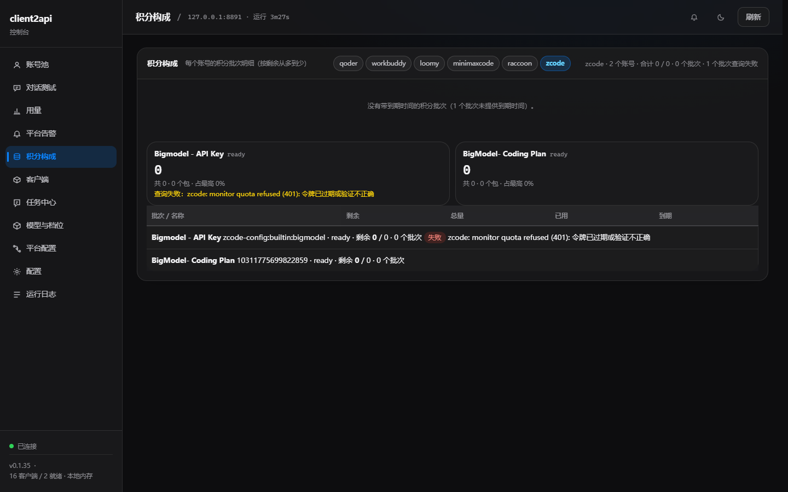
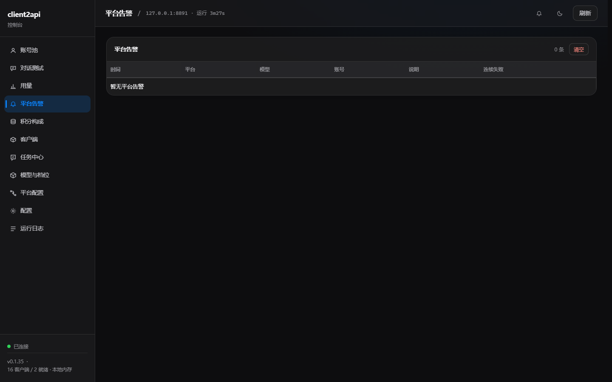
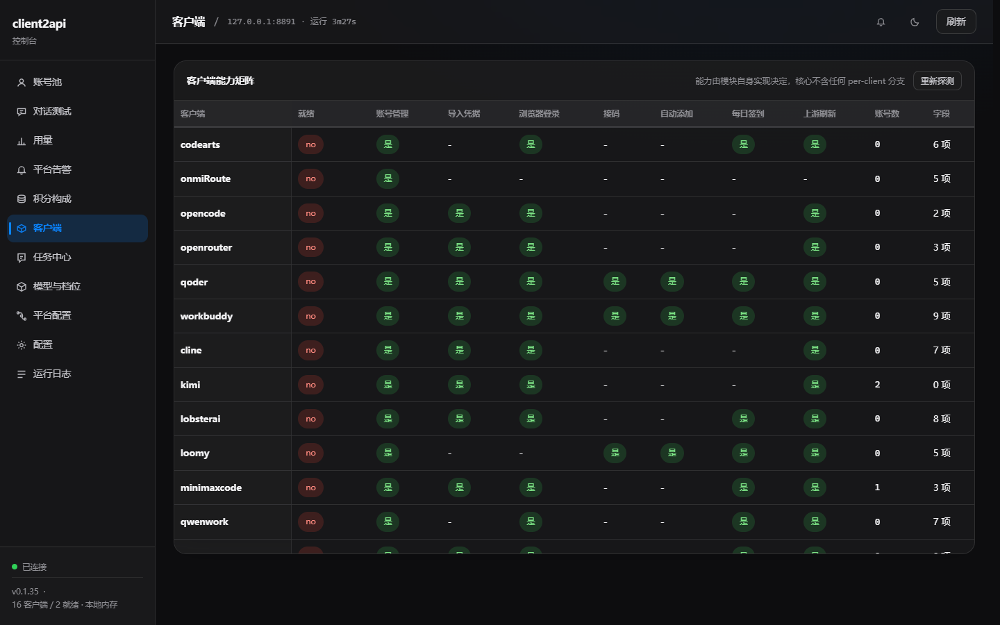
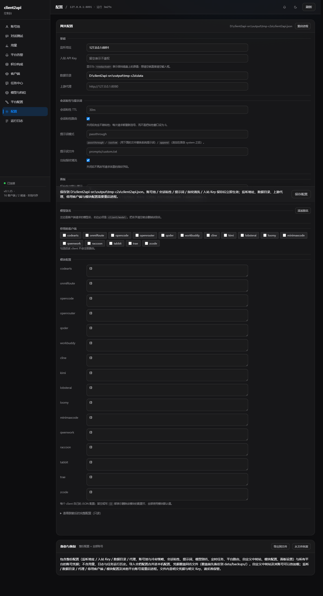
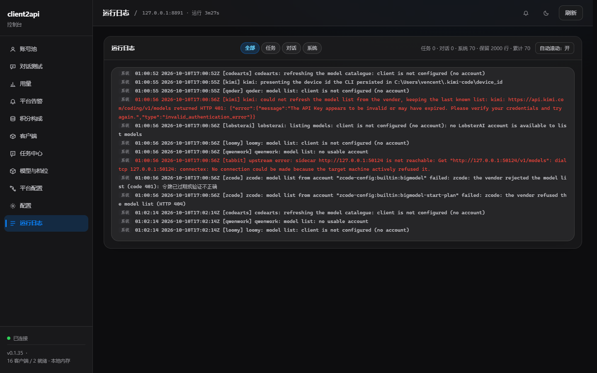

# client2api 使用教程

[English](README.md) | [简体中文](README.zh-CN.md) | [使用教程](TUTORIAL.zh-CN.md)

本文介绍 client2api 的完整使用流程，从安装、添加账号，到模型路由、Responses 接口、任务中心、用量统计和故障排查。

> **使用范围**
>
> client2api 仅限个人自用和学习。它用于聚合你自己拥有的账号和 Key，不提供服务器架设方案，也不允许用来搭建公网、共享或商业中转服务。
>
> 请只在本机运行，不要把端口暴露到互联网。使用前请确认你遵守了每个上游平台的账号规则、服务条款和 API 政策。


## 1. 安装与首次启动

### Windows 安装包

1. 从 [Releases](https://github.com/Cvencent/client2api/releases) 下载最新的 `client2api-setup-<version>.exe`。
2. 双击安装，按向导完成安装。
3. 安装器会启动托盘程序。后续可以从托盘菜单打开面板或修改监听端口。
4. 默认面板地址通常是：

```text
http://127.0.0.1:8790/panel/
```

端口、开机启动等设置可以在托盘菜单里修改。升级会替换程序文件，但保留 `configs/client2api.json` 和 `data/`，配置、账号、用量和任务数据不会因为升级丢失。

### 从源码运行

先准备 Go 和 C 工具链，再设置环境变量：

```powershell
$tools='D:\client2api-lab\_tools'
$env:PATH="$tools\go\bin;$tools\w64devkit\bin;$env:PATH"
$env:GOCACHE="$tools\gocache"
$env:GOTMPDIR="$tools\gotmp"
$env:GOMODCACHE="$tools\gomodcache"
$env:GOFLAGS='-mod=mod'
$env:GOPROXY='off'
$env:CGO_ENABLED='0'
go build -o client2api.exe ./cmd/client2api
.\client2api.exe -config configs\client2api.json
```

源码模式常用端口是 `8788`，安装版常见端口是 `8790`。以面板或配置文件里的 `listen` 为准。不要让两个实例共用同一个 `data/` 目录，也不要让两个实例抢同一个端口。

## 2. 打开面板与设置入站 Key

打开面板后，先进入 **配置** 页面设置顶层 `api_key`。

这个 `api_key` 是调用网关时使用的入站 Key，不是上游平台的账号密码。设置后可以这样调用：

```http
Authorization: Bearer <你的入站 Key>
```

面板的 `/panel/api/*` 也支持：

```http
X-Api-Key: <你的入站 Key>
```

如果 `api_key` 留空：

- 网关不校验入站请求。
- 面板 API 也不做鉴权。
- 这适合只监听 `127.0.0.1` 的本机开发，但不适合任何会被其他设备访问的场景。

建议只监听 `127.0.0.1`，设置足够长的随机入站 Key，不要把面板暴露到公网，也不要把账号凭据或 `data/` 提交到 Git。

## 3. 添加账号

进入 **账号池**，点击右上角 **添加账号**。常见方式有三种。

### 浏览器登录

适合支持网页登录或设备授权的平台，按页面提示完成登录即可。不同平台可能支持浏览器登录、设备码、本机回调、二维码、短信或接码登录。Gemini / Google Cloud Code Assist 走 Google OAuth 登录；支持接码的平台可以填写接码平台 token；接码代理是可选字段，只保存在当前浏览器。

### 导入凭据

如果平台客户端已经在本机登录，可以使用本地发现或导入功能读取凭据，也可以选择该客户端导出的 JSON 文件。导入只处理该平台自己的凭据格式。

### 手动添加

部分平台支持手动填写 Key、账号或 API 地址，适合已有 API Key、自定义 OpenAI 兼容中转站或不想使用浏览器登录的情况。添加后建议立刻点击 **测试**，确认凭据能访问上游模型。

## 4. 管理账号池

账号池是日常使用最频繁的页面。

### 账号与通道

一个上游账号可能对应多条通道。例如 ZCode 账号可能同时有 JWT 和 coding-plan API Key。面板会把这些通道聚合为同一个账号，展开后显示各条通道。某条通道失效时可以单独处理；只要账号里还有可用通道，账号整体仍可能保持可用。

### 状态颜色

| 状态 | 含义 |
|---|---|
| 可用 | 账号可以参与调度 |
| 冷却中 | 因为限流或临时错误被暂时跳过 |
| 已耗尽 | 余额或免费额度为 0，已退出轮换；充值、签到或余额刷新读到正数后自动恢复 |
| 风控 | 平台行为限制，重登通常无效 |
| 账号异常 | token、session 或凭据失效，通常可以重登修复 |
| 已停用 | 操作员手动停用 |
| 未知 | 还没有足够信息判断 |

绿色表示可用，黄色表示冷却，红色表示风控或账号异常。点击测试、刷新余额或恢复探测可以让状态重新计算。

### 常用操作

- **测试**：发起一次真实的最小请求，确认账号、模型和上游网络都可用。
- **启用 / 停用**：停用后不再参与调度。
- **刷新余额**：读取账号剩余额度、积分或 tokens。
- **刷新凭据**：在上游支持时续期 access token。
- **签到**：执行该平台支持的每日签到或领取任务。
- **领取 / 积分任务**：打开账号任务弹层，查看可执行任务。
- **恢复**：尝试解除临时冷却或恢复失效状态。
- **重登**：凭据失效时重新登录并覆盖旧凭据。
- **接码重登**：支持接码的平台可以在浏览器登录流程中重新接码。
- **删除**：删除该账号的本机凭据文件。

风控账号通常不会显示接码重登。重登更适合账号异常、session 过期、token 失效这类问题。

### 账号标识、备注与优先级

- **账号标识**用于记录手机号、邮箱或昵称，方便辨认。
- **备注**是给账号起的自定义名字，会显示在账号池和用量记录里。
- **优先级**影响调度顺序。数字越小越优先，允许使用负数。
- **在途**显示账号当前正在处理的请求数量。
- **成功 / 失败**显示调度结果。
- **用量**显示调用次数和 token 统计。
- **到期**显示凭据的预计过期时间。

### 搜索、筛选、排序与分页

账号池支持按账号或备注搜索、按状态筛选，并可按账号、状态、模型、优先级、余额、成功率、在途、用量、最近成功、到期排序。分页可切换 20、50、100、200 条，且按账号分组切，多通道账号不会被拆到两页。

### 模型可用情况

点击账号的 **模型** 列，可以查看该账号的模型明细：绿色表示当前可用，黄色表示限流并显示解除时间，红色表示该账号不支持这个模型，灰色表示操作员已手动关闭。平台上报逐模型状态时按上报显示；没有上报时回退到平台模型目录，按全部可用展示。WorkBuddy 保留模块自己的模型策略，其它平台使用网关共享策略；两种都会在保存后立刻影响下一次选号。刚添加账号后，建议先刷新模型或执行一次测试。

上游返回 429 时，网关会按 **平台 + 账号 + 模型** 记住一段冷却：首次 60 秒，连续失败翻倍，封顶 30 分钟；上游给了 `Retry-After` 就优先用它。冷却期间这个账号不会再被选中来调用这个模型，但其它账号、其它平台和同账号的其它模型仍然可用。

## 5. 配置平台与自定义中转站

进入 **平台配置**，这里负责调度规则和平台级配置。

### 模型路由组

模型路由组用于把同一个模型在不同平台上的不同名字绑成一组。常见写法：

| 写法 | 含义 |
|---|---|
| `zcode/GLM-5.3` | 固定使用 zcode 平台的 GLM-5.3 |
| `GLM-5.3` | 在唯一提供该模型的平台中路由 |
| `gpt-4o` | 使用自定义别名 |
| `Auto/GLM-5.3` | 在提供该模型的所有平台中按优先级路由 |
| 模型组名 | 在组内所有成员中按优先级路由 |
| 组内成员的裸模型名/别名 | 优先使用该成员，失败再按组内优先级回退到其它成员 |

`Auto/<模型>` 会动态发现所有实际提供该模型、且没有被黑名单排除的平台。需要固定平台时，使用显式的 `平台/模型`。

请求组名时按组内优先级选成员；请求某个成员的裸模型名时，优先用精确匹配的那个成员，它近期不可用或调用失败时，再按优先级回退到组内其它成员。只要写成带平台前缀的 `平台/模型`，就是明确指定平台：即使这个成员也属于某个模型组，请求仍只由该平台应答，失败也不会被模型组改道。

### 添加自定义中转站

点击 **添加中转站**，填写平台 ID、平台名称、API 地址、首个 API Key（可选）以及输出限制字段。平台 ID 只能使用小写字母、数字和连字符，并且以小写字母开头。

保存后点击 **扫描模型**。网关会用每个启用 Key 请求上游的 `GET /models`，扫描结果会合并为平台模型目录。扫描失败会保留上一次成功的目录。删除中转站不会立刻删除账号文件；重新添加相同平台 ID 和 API 地址可以恢复原来的 Key 池。

### 平台调度规则

常用调度项包括：

- **平台优先级**：数字越小越优先，允许负数。
- **分时优先级**：在指定北京时间段覆盖基础优先级。
- **账号优先级**：为平台内不同账号设置不同顺序。
- **模型黑名单**：禁止该平台调用某些模型。
- **平台总并发**：限制整个平台同时在途的请求数。
- **网关单账号并发**：限制每个账号同时在途的请求数。
- **最低余额**：低于阈值时不再调度该平台账号。

分时规则使用北京时间，支持跨零点区间，规则不能重叠。保存后通常立即热生效，不需要重启。

### 路由链预演

进入 **平台配置 → 链路测试**，输入模型名后点 **测试链路**，可以查看静态故障切换顺序：每个平台实际会使用哪个模型、有效优先级、优先级来源，以及它来自平台优先级、分时窗口、模型组还是 `Auto/<模型>` 动态池。

这个页面只做本地预演，不调用上游，也不读取账号健康状态。所以它适合确认“路由规则会选谁”，但不能代替真实测试；实际请求还会受账号可用性、冷却、并发和余额影响。

## 6. 模型与档位

进入 **模型与档位**，点击 **重新获取** 从各平台刷新模型目录。表格会显示模型来源、倍率、默认档、思考档位、上下文长度、最大输出、输入价、输出价和缓存读取价。

模型能力字段和价格的解析顺序是：

```text
操作员手动值 > 模块上报值 > 内置或官方预设
```

可以手动修改上下文长度、最大输出 tokens、输入价格、输出价格、缓存读取价格和部分能力字段。手动值保存在 `data/model_context.json`，升级不会丢失，使用行内恢复默认功能可以还原。

价格显示单位是人民币 / 百万 tokens。缓存读取价格存在时，缓存输入按缓存价计算；没有缓存价时，全部输入按普通输入价计算。未知价格显示 `—`，不会当成 0 元；显式免费的模型才显示 `¥0`。DeepSeek Flash / Pro 使用官方人民币峰谷价，其他厂商优先使用官方价表，缺失时回退到 models.dev 快照。

### 对外模型白名单

进入 **模型与档位 → 对外模型**，可以选择哪些最终模型 ID 对外提供。这里控制的是路由完成后的结果，包括 `平台/模型`、`Auto/<模型>`、模型组名、别名和语音转写模型；每个最终 ID 独立控制，勾选组内成员不会自动开放组名，勾选别名目标也不会自动开放别名。

页面支持搜索、按类型筛选、全选、反选、清空和逐项勾选。选择“全部模型”会删除 `exposed_models` 配置，表示全部开放；选择“仅勾选模型”后，空选择表示一个模型也不对外。保存后会写入配置并热重载，不需要重启。配置里存在、但当前模型目录没有的 ID 会保留成 `missing` 行，保存不会把它丢掉。

## 7. 使用 Chat Completions

Chat Completions 是最常见的 OpenAI 兼容入口：

```http
POST /v1/chat/completions
```

示例：

```powershell
curl.exe -s -X POST http://127.0.0.1:8790/v1/chat/completions `
  -H "Content-Type: application/json" `
  -H "Authorization: Bearer <你的入站 Key>" `
  -d '{"model":"zcode/GLM-5.3","messages":[{"role":"user","content":"你好"}],"stream":true}'
```

大多数 OpenAI 兼容客户端只需要填写：

- Base URL：`http://127.0.0.1:8790/v1`
- API Key：面板里设置的入站 Key
- Model：平台/模型、裸模型名、别名、模型组或 `Auto/<模型>`

如果请求里的模型没有加平台前缀，网关会尝试在唯一的平台中解析。若有歧义，会返回错误并列出候选。固定平台时使用 `平台/模型`。常用检查接口包括 `GET /v1/models`、`GET /v1/status` 和 `GET /healthz`。

## 8. 使用 Responses API、Anthropic Messages 与 Codex

Responses 接口：

```http
POST /v1/responses
```

示例：

```powershell
curl.exe -s -X POST http://127.0.0.1:8790/v1/responses `
  -H "Content-Type: application/json" `
  -H "Authorization: Bearer <你的入站 Key>" `
  -d '{"model":"zcode/GLM-5.3","input":"你好","stream":true}'
```

Codex 可以直接指向本网关：

```toml
model = "zcode/GLM-5.3"
model_provider = "client2api"

[model_providers.client2api]
name = "client2api"
base_url = "http://127.0.0.1:8790/v1"
wire_api = "responses"
env_key = "CLIENT2API_KEY"
```

设置环境变量：

```powershell
$env:CLIENT2API_KEY = "<你的入站 Key>"
```

### 使用 Anthropic Messages（Claude Code）

网关也提供 Anthropic Messages 入站接口：

```http
POST /v1/messages
POST /v1/messages/count_tokens
```

Claude Code 或 Anthropic SDK 把 Base URL 指向 `http://127.0.0.1:8790`，并使用同一个入站 Key 即可。这个入口支持字符串或 block content、system、tools、tool result、thinking、usage、流式 SSE、非流式响应和 Anthropic 风格错误；`count_tokens` 在本地估算，不请求上游。

Responses 接口支持 `instructions`、字符串或数组形式的 `input`、消息、文本、图片、工具调用、函数结果、推理摘要和加密 agent 内容的安全处理，并按 Codex 解析器需要的事件顺序输出流式事件。达到输出上限时，流式和非流式响应都会标记为 `incomplete`。

需要注意：接口是无状态的，`store` 和 `previous_response_id` 会被接受但不会在上游保存对话；调用方需要在 `input` 里回放历史。内置工具会被跳过，只翻译函数工具。非流式响应请从 `message` 项里读取文本。

## 9. 使用对话测试

进入 **对话测试**：选择模型，必要时用筛选框缩小列表；选择要测试的账号；输入消息并发送；流式输出过程中可以停止。

这个页面适合新加账号后的真实请求测试、比较不同平台同一模型的响应、检查工具调用和流式输出，以及在接入正式客户端前验证入站 Key 和模型路由。账号池里的 **测试** 也是真实请求，但对话测试更适合人工观察回答质量、速度和失败信息。

## 10. 使用任务中心

任务中心有三个主要部分：定时任务、批量执行和任务看板。

### 定时任务

定时任务按平台分 Tab，时间使用北京时间，每个平台可以单独配置，留空表示该平台的这个任务永不运行。改动后点击右上角保存并生效。同一账号的任务严格串行，不会重叠；不同账号之间默认有间隔，避免平台反滥用检查。

常见任务包括签到、领取每日积分、余额刷新、凭据续期、恢复探测和平台自定义批次。

### 恢复探测

每个平台都有一条恢复探测任务，会检查冷却中的账号、额度耗尽的账号、被限流的账号和即将过期的凭据。探测成功后账号可以重新回到调度。平台可以单独覆盖探测间隔和随机范围。

### 每日余额刷新

每个平台可以配置每日余额刷新任务。带每日额度的平台跨天后会重置额度，这次扫描会刷新所有账号的余额，让刚恢复额度的账号自动回到调度。

### 批量执行

批量执行适合对多个账号一次执行同一类任务：选择平台、选择账号、选择任务、执行并查看结果。如果模块不支持某个批量任务，面板会返回明确提示。

### 任务看板

任务看板用于查看账号的任务状态。已扫描过的账号会优先使用缓存，新账号会主动拉取；可以点击 **刷新任务状态** 强制重新读取。当账号没有可自动执行的待办时，卡片会变为绿色。任务缓存保存在 `data/panel/task_board_cache.json`。

## 11. 查看用量、积分和告警

### 用量

用量页面包含总览、最近调用、按账号和按模型统计。总览指标有成功率、输入 tokens、输出 tokens、合计 tokens、缓存命中率、总花费和平均延迟。

缓存的统计只使用上游确实上报了缓存字段的请求。旧记录没有缓存字段时会被排除，不会当成未命中。

最近调用会显示时间、平台、模型、思考强度、会话 ID、账号、结果、候选平台、输入/输出/合计 tokens、缓存 tokens、缓存命中率、人民币花费、耗时和速率。会话 ID 优先使用调用方传入的值；没有传入时，面板会尝试从内容生成推断值，并明确标注为推断。

### 积分构成

积分构成显示每个账号的积分批次，按剩余数量排序并显示有效期，帮助判断哪些额度会先过期。点击刷新可以读取最新积分批次。如果平台不提供积分批次接口，面板不会伪造数据。

### 平台告警

平台告警记录连续失败的平台和模型、关联账号、错误说明、连续失败次数和发生时间。可以直接清空告警列表。告警用于快速定位上游异常，不会替代运行日志。

### 客户端

客户端页面展示各模块的能力矩阵，包括是否就绪、是否支持账号管理、是否支持导入、是否支持浏览器登录、是否支持每日签到、是否支持上游刷新和当前账号数。

### 运行日志

运行日志提供结构化日志和频道筛选，常见频道包括网关、账号、调度、任务、对话和上游错误。排查问题时，先看运行日志，再看平台告警，最后看账号池状态。

## 12. 网关配置与热更新

进入 **配置** 页面可以编辑核心配置。常用字段包括：

```json
{
  "listen": "127.0.0.1:8790",
  "api_key": "",
  "data_dir": "data",
  "proxy": "",
  "egress": {
    "enabled": false,
    "mode": "subscription",
    "url": "",
    "mihomo_path": ""
  },
  "aliases": {},
  "exposed_models": null,
  "disabled": [],
  "sources": {},
  "platforms": {},
  "model_groups": {},
  "session_sticky": {},
  "pool": {},
  "features": {},
  "cooldown": {},
  "prompt": {},
  "schedule": {},
  "panel": {},
  "clients": {}
}
```

关键字段：`listen` 是监听地址，个人使用建议保持 `127.0.0.1`；`api_key` 是入站 Key，为空表示不鉴权；`data_dir` 是账号和运行数据目录；`proxy` 是所有上游请求使用的代理；`egress` 是可选的出口中继；`aliases` 是模型别名；`exposed_models` 是对外模型白名单（`null` 表示全部开放，`[]` 表示全部关闭，平时在 **模型与档位 → 对外模型** 里勾选，不必手改）；`disabled` 是停用模块；`sources` 是自定义中转站；`platforms` 是平台级路由策略；`clients` 是各模块自己的配置；`model_groups` 是模型路由组覆盖；`session_sticky` 是会话粘性；`pool` 是号池治理；`cooldown` 是软限流和冷却时间；`prompt` 是提示词处理模式；`schedule` 是计划任务默认配置；`panel` 是面板展示项。

出口中继的 `egress.enabled` 打开后，`mode` 可选 `client` 或 `subscription`。`client` 模式的 `url` 填 HTTP、HTTPS、SOCKS5 或 SOCKS5H 代理地址；`subscription` 模式的 `url` 填订阅链接，程序会调用 `mihomo_path` 指定的 mihomo（留空则自动查找），并把网关流量指向它启动的 loopback mixed port。启用后优先于顶层 `proxy`。订阅 URL 会被当成凭据，面板只显示脱敏值。

模块自己的 `clients.<模块>` 配置不在配置页，而在 **平台配置 → 平台与模型** 里：
展开某个平台卡片，里面的「模块配置」就是该模块的常用项，已经整理成中文控件。输入框
用于地址、路径、模型清单等，布尔项和固定取值项使用下拉框，说明文字会写在控件下面。
控件留空表示使用模块内置默认值；要恢复整张卡片，清空所有控件并把 `其它键（JSON）`
留空或写成 `{}`。卡片底部只放面板尚未整理的键，通常保持原样即可。WorkBuddy 的提示词
模式/文件和出站指纹清洗也只作用于它自己，同样收在它的平台卡片里。模块配置保存后需要
重启进程生效；号池、提示词与指纹清洗保存后热加载。

通常可以热更新、无需重启的内容包括平台优先级、分时优先级、模型黑名单、并发限制、模型路由组、对外模型白名单、会话粘性、冷却策略、提示词模式，以及自定义中转站和它的账号池。通常需要重启的内容包括 `listen`、`data_dir`、`proxy`、`egress`、`disabled`、部分模块级配置和部分面板展示配置。

### 备份与恢复

配置页的备份与恢复会包含监听地址、入站 Key、数据目录、代理设置、出口中继、账号池与冷却策略、会话粘性、提示词、模型别名与路由组、定时任务、平台路由、自定义中转站、模块配置、模型上下文与价格等手工覆盖，以及所有平台的账号凭据（含 WorkBuddy 已停用的账号）。恢复时会合并配置，模型覆盖整体替换，凭据覆盖同名文件，覆盖前会先备份到 `data/backups/`。备份不含用量、日志、任务运行历史、学习到的上下文窗口和设备身份；如果 WorkBuddy 配置了自定义 `accounts_dir`，其账号不在快照内，导出时会提示。备份文件里包含明文凭据、明文 Key 和可能的出口订阅链接，必须妥善保管。

## 13. 路由、冷却、并发和粘性

一次请求通常会按下面的信息选择账号：请求里显式的平台前缀、模型别名和路由组、`Auto/<模型>` 动态聚合、平台优先级和分时优先级、账号优先级、账号状态、冷却、余额、模型可用性、并发限制，以及会话粘性绑定。

显式写成 `平台/模型` 时只由这个平台应答，失败也按这个平台的失败返回，不会被模型组悄悄改道到别的平台；裸模型名和模型组成员才走组内故障切换。`Auto/<模型>` 始终跳过模型组，直接聚合各平台目录。

上游返回 429 时，网关会按「平台 + 账号 + 模型」记一段冷却；首次 60 秒，连续失败翻倍，封顶 30 分钟，上游给了 `Retry-After` 就优先使用。零余额或明确额度耗尽则不会套用定时冷却，而是直接退出轮换，直到充值、签到或余额刷新读到正数。session 失效、风控等错误会按账号状态处理。恢复探测或手动测试可以提前恢复。

如果厂商在已经打开的 SSE 流里才返回额度、鉴权、限流或 WAF 错误，网关会先读第一帧判断；可重试错误会关闭这个流，转交给下一个候选平台，已经读到的帧不会丢。

并发限制分为平台总并发、账号并发和网关多账号并发。当所有可用账号都达到并发上限时，网关会返回背压错误，调用方应稍后重试，而不是认为路由坏了。

支持会话粘性的平台会把同一段对话尽量固定到同一个账号，以利用上游提示缓存，减少重复计费。粘性通常按“平台 + 会话”绑定。账号被停用、冷却或缺少当前模型时，绑定会被忽略并重新选择账号。

## 14. 面板 API 概览

如果要在本机做自动化，可以使用 `/panel/api/` 下的接口。

常用接口：

```text
GET    /panel/api/status
GET    /panel/api/clients
POST   /panel/api/reload
GET    /panel/api/overview
GET    /panel/api/logs?lines=N
GET    /panel/api/models
POST   /panel/api/models/refresh
GET    /panel/api/exposed_models
POST   /panel/api/route_plan
GET    /panel/api/model_probes
GET    /panel/api/usage?window=HOURS
POST   /panel/api/usage/save
GET    /panel/api/config
POST   /panel/api/config
```

账号接口：

```text
GET    /panel/api/clients/<name>/capabilities
GET    /panel/api/clients/<name>/accounts
POST   /panel/api/clients/<name>/accounts
DELETE /panel/api/clients/<name>/accounts/<id>
POST   /panel/api/clients/<name>/accounts/<id>/enabled
POST   /panel/api/clients/<name>/accounts/<id>/test
POST   /panel/api/clients/<name>/accounts/<id>/checkin
POST   /panel/api/clients/<name>/accounts/<id>/revive
POST   /panel/api/clients/<name>/accounts/<id>/balance
GET    /panel/api/clients/<name>/balances
POST   /panel/api/clients/<name>/balances/refresh
GET    /panel/api/clients/<name>/login/regions
POST   /panel/api/clients/<name>/login
GET    /panel/api/clients/<name>/login/<session>
DELETE /panel/api/clients/<name>/login/<session>
POST   /panel/api/clients/<name>/import
POST   /panel/api/clients/<name>/import/bundle
```

模块没有实现对应能力时通常会返回 `501`，并说明缺少什么。账号 ID 可能包含需要 URL 转义的字符，自己调用 API 时要正确编码。设置顶层 `api_key` 后，所有 `/panel/api/*` 都要求 `Authorization: Bearer <key>` 或 `X-Api-Key: <key>`。HTML 外壳不会拦截，因为页面必须先加载才能输入 Key。

## 15. 故障排查

### 401 invalid_api_key

入站 Bearer Key 不正确。检查面板配置里的 `api_key`、客户端里的 Key、请求头格式，以及是否把上游平台 Key 误当成入站 Key。

### 503 no_healthy_account

没有可用账号。检查账号池是否有账号、账号是否启用、是否在冷却/风控/异常状态、是否达到并发限制、平台是否缺少当前模型、中转站是否扫描过模型。

### 429 rate_limit_exceeded

上游限流或本地并发背压。降低平台或账号并发，等待冷却结束，增加可用账号，并检查是否短时间内重复触发恢复探测。

### 429 quota_exhausted

额度耗尽。刷新余额、执行签到或领取任务、确认积分是否过期，以及是否真的到了每日或滚动窗口限制。

### 401 account_auth_failed 或 401 session_dead

账号凭据失效。重新登录、刷新凭据，支持接码时使用接码重登，并确认账号没有被上游风控。

### 403 waf_ip_blocked

上游 WAF 拦截了当前 IP 或行为。暂停高频请求、降低并发、检查代理设置、稍后重试。不要用自动化绕过平台风控。

### 400 content_blocked

上游内容审核拦截。检查请求内容、系统提示词和工具参数是否触发内容策略。

### 504 upstream_timeout

上游超时。检查网络、代理、上下文长度、输出上限和上游健康状态。单次超时可以重试；持续超时先切换平台或模型。

### 模型找不到

检查模型是否已在 **模型与档位** 拉取、是否需要加平台前缀、是否是别名或路由组、`Auto/<模型>` 是否有成员、中转站扫描是否成功，以及平台黑名单是否排除了该模型。还要检查 **模型与档位 → 对外模型**：如果启用了白名单，被隐藏的最终 ID 即使按名字调用也会被拒绝。

### 自定义中转站扫描失败

检查 API 地址是否需要 `/v1`、Key 是否有效、上游是否支持 `GET /models`、是否需要代理，以及是否应该使用 `max_completion_tokens`。扫描失败会保留上一次成功目录；修改 API 地址后需要重新扫描。

### 出口中继不生效

`egress` 属于需要重启的配置，保存后要重启进程。`client` 模式检查代理 URL 是否是可用的 HTTP/HTTPS/SOCKS5/SOCKS5H 地址；`subscription` 模式检查订阅 URL、`mihomo_path` 以及 `data/egress/mihomo.log`。出口中继启用时优先于顶层 `proxy`，两者不要同时指望生效。

### 面板打不开

检查进程是否在运行、托盘菜单里的端口、浏览器地址是否使用了正确的 `127.0.0.1:<端口>`、是否有另一个实例占用了端口，以及运行日志里是否有启动错误。

### /healthz 返回 503

通常表示进程在运行，但没有可服务的账号。先检查账号池和上游状态。

## 16. 数据安全与升级

重要目录：

- `configs/client2api.json`：本机配置和入站 Key。
- `data/`：账号凭据、运行状态、用量记录和任务数据。
- `data/backups/`：恢复备份。
- `logs/`：运行日志（如果启用）。

这些内容都可能包含敏感信息。不要提交到 Git，不要上传到公共网盘，不要发给别人。

如果启用了 `egress` 的订阅模式，订阅 URL 也属于凭据；面板读取配置时会脱敏，但配置文件、备份包和 `data/egress/` 仍应按敏感数据处理。

给其他人分发时使用空数据包：

```powershell
pwsh -File installer\build.ps1 -NoData
```

`-NoData` 不会带账号和本机配置。不带 `-NoData` 的安装包会包含当前账号数据，只能自己保留。

升级只替换程序文件，保留 `configs/client2api.json`、`data/`、账号池、用量历史和任务数据。升级前仍然建议在面板里导出备份。升级后先打开面板，检查账号池、模型目录和任务状态是否正常。

不要监听 `0.0.0.0` 后暴露到公网，不要给别人提供共享中转，不要多个实例共用同一个 `data/`，不要用同一个端口启动两个实例，不要把 `data/` 或配置上传到公开仓库，也不要用本项目绕过平台额度或风控。

## 17. 使用范围总结

client2api 适合聚合自己拥有的多个 AI 客户端账号、在本机统一调用 Chat Completions 和 Responses、给自己使用的 Codex 或 OpenAI 兼容客户端提供网关、管理账号、任务、余额、用量和价格，以及学习多平台协议适配、账号池调度和网关实现。

client2api 不适合公网服务器架设、面向多人的共享中转、商业售卖访问权限、绕过上游账号限制或风控，也不适合作为任何平台的官方替代品。请把它当作个人自用、学习使用的工具，并遵守所有相关平台的服务条款。
## 18. 面板页面速览

下面几张图对应前面提到的其余面板页面，可以用来快速确认每个功能在哪里。

| 积分构成 | 平台告警 |
|---|---|
|  |  |

| 客户端 | 配置 |
|---|---|
|  |  |

| 运行日志 |
|---|
|  |

面板的十一个视图分别是：账号池、对话测试、用量、平台告警、积分构成、客户端、任务中心、模型与档位、平台配置、配置、运行日志。顶部主题切换、统一刷新和添加账号按钮在所有个人使用流程中都可用。
